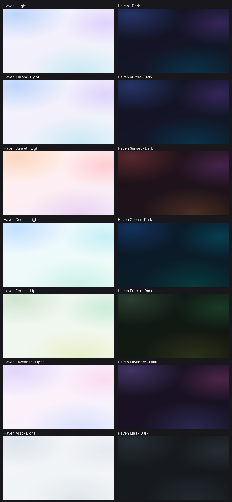

# Haven

A rounded Material Design 3 theme for Home Assistant with light and dark mesh-gradient backgrounds.

[](https://github.com/hacs/integration)
[](LICENSE)
[](https://github.com/OWNER/haven-theme/actions/workflows/validate.yaml)

## Features

- Rounded Material Design 3 look: large corner radii, borderless translucent cards.
- The header is moved to the bottom and turned into a navigation-style footer (via card-mod), with the current view highlighted.
- Seven themes: one default plus six colour variants.
- Separate light and dark gradients for every variant.
- Dashboard background images blend over the theme gradient instead of replacing it.

## Screenshots

Gradient previews of every variant (light on the left, dark on the right):



## Variants

| Theme | Description |
| --- | --- |
| `Haven` | Default, identical to Aurora |
| `Haven Aurora` | Blue-violet with a hint of teal |
| `Haven Sunset` | Peach, coral and plum |
| `Haven Ocean` | Blue, cyan and teal |
| `Haven Forest` | Sage, green and moss |
| `Haven Lavender` | Lilac and pink |
| `Haven Mist` | Subtle, neutral grey-blue |

## Requirements

- Home Assistant 2026.6 or newer.
- [card-mod](https://github.com/thomasloven/lovelace-card-mod) installed as a frontend resource. It is required for the footer navigation and for background blending.

## Installation

### HACS

1. Open HACS, then the menu (three dots), then **Custom repositories**.
2. Add `https://github.com/rochmir/haven-theme` with category **Theme**.
3. Download **Haven** from HACS.
4. Make sure themes are loaded (see below) and reload them.

### Manual

1. Copy `themes/haven.yaml` into your `config/themes/` directory.
2. In `configuration.yaml`, make sure themes are included:

   ```yaml
   frontend:
     themes: !include_dir_merge_named themes
   ```

3. Reload themes: **Developer Tools -> Actions -> `frontend.reload_themes`** (or restart Home Assistant).

## Usage

- Per user: **Profile -> Theme**, pick a Haven theme, and choose **Light**, **Dark** or **Auto** for the mode.
- Per view: set `theme: Haven Ocean` on a dashboard view.
- Server default:

  ```yaml
  action: frontend.set_theme
  data:
    name: Haven Sunset
    mode: dark   # optional: light or dark
  ```

## Customization

### Where the background lives

Each theme defines `lovelace-background` under `modes: dark:` and `modes: light:`. Edit the value in the variant you use.

### Gradient layers

Every background is four layers, listed top to bottom:

1. Three `radial-gradient(ellipse ...)` glows, each fading to transparent, placed at the top left, top right and bottom.
2. One `linear-gradient(160deg, ...)` base with three colour stops.

All layers use `fixed` so the gradient stays still while the view scrolls.

### Add your own variant

Colours and sizes are shared through YAML anchors (`&haven_dark`, `&haven_light`, `&haven_common`). Append a new theme to `themes/haven.yaml`:

```yaml
Haven Custom:
    card-mod-theme: 'Haven Custom'
    modes:
        dark:
            lovelace-background: >-
                radial-gradient(ellipse 80% 70% at 12% 8%, rgba(200,84,84,0.34), transparent 60%) fixed, radial-gradient(ellipse 70% 60% at 92% 22%, rgba(124,62,146,0.40), transparent 58%) fixed, radial-gradient(ellipse 80% 70% at 68% 98%, rgba(206,126,72,0.26), transparent 60%) fixed, linear-gradient(160deg, #1c1218 0%, #20131c 50%, #1a1316 100%) fixed
            <<: *haven_dark
        light:
            lovelace-background: >-
                radial-gradient(ellipse 80% 70% at 12% 8%, rgba(255,205,176,0.75), transparent 60%) fixed, radial-gradient(ellipse 70% 60% at 92% 22%, rgba(255,184,190,0.60), transparent 58%) fixed, radial-gradient(ellipse 80% 70% at 68% 98%, rgba(226,198,240,0.65), transparent 60%) fixed, linear-gradient(160deg, #fff4ee 0%, #fdeef2 50%, #f6eefa 100%) fixed
            <<: *haven_light
    <<: *haven_common
```

`card-mod-theme` must equal the theme name, or the card-mod rules will not apply. If you put the theme in a separate file, copy the anchors too, since anchors do not carry across files.

### Custom font

Haven uses the stack `Roboto, 'Noto Sans', sans-serif` and ships no font files. To use another font, load it with a CSS resource (`@font-face`, or a stylesheet you host in `/config/www`) added under **Settings -> Dashboards -> Resources**, then edit `primary-font-family` in `haven.yaml`:

```yaml
primary-font-family: "'My Font', Roboto, 'Noto Sans', sans-serif"
```

All other font variables follow `primary-font-family`.

## Credits

Based on [material-rounded-theme](https://github.com/Nerwyn/material-rounded-theme) by Nerwyn.

## License

Apache License 2.0. See [LICENSE](LICENSE) and [NOTICE](NOTICE).
